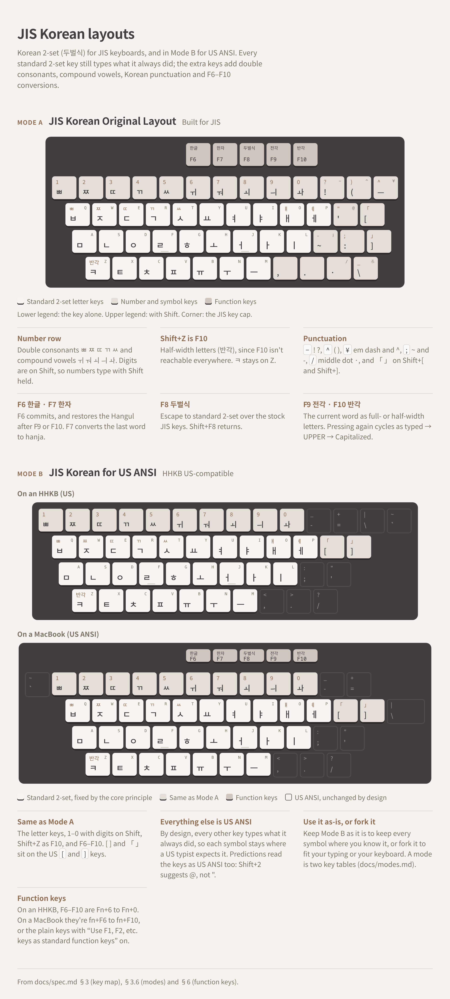

# JIS Korean

A Korean 2-set (두벌식) input method for JIS keyboards, for macOS, Minecraft, Windows and iPadOS, with a
browser playground.

**Try it in your browser: [jis-korean.sjun.me](https://jis-korean.sjun.me)**

<picture>
  <source media="(prefers-color-scheme: dark)" srcset="docs/layout/jis-korean-layouts-dark.png">
  
</picture>

Mode A is the original layout, built for JIS. Mode B carries it onto US ANSI keyboards, and Mode C
onto UK ISO keyboards ([spec §3.6](docs/spec.md#36-modes)); adding a mode of your own is described in
[docs/modes.md](docs/modes.md). The drawing is [docs/layout/jis-korean-layouts.html](docs/layout/jis-korean-layouts.html).

- Spec: [docs/spec.md](docs/spec.md)
- `engine/`: core engine (shared by all platforms)
- `mac/`: macOS input method
- `minecraft/`: Minecraft (Fabric mod)
- `windows/`: Windows input method (TSF)
- `ipados/`: iPadOS (stub)
- `web/`: browser playground, deployed at [jis-korean.sjun.me](https://jis-korean.sjun.me)

## Install with an AI assistant

Open this repository in a coding assistant such as Claude Code and say:

```
Read docs/interactive-prompts/start.md and follow it.
```

It asks which platform and keyboards you have and which remap tools are OK with you, then walks you
through the setup. It asks before looking at anything on your computer and before installing each
tool. Without the repository, paste [start.md](docs/interactive-prompts/start.md) into a coding
assistant started in an empty folder: it fetches the repository there first. See
[docs/interactive-prompts](docs/interactive-prompts/README.md).

## Build order

Platforms are built in this order: **macOS → Minecraft → Windows → iPadOS**.

Android and iPhone aren't planned here; they'll be covered by a separate input method.

---

Want to try out JIS, but only have a US ANSI board?
[Try out these remaps!](docs/mac-ansi-87-key-recommended/README.md)

Have an HHKB US and wondering about an HHKB JIS?
[Try kana and JIS Korean on it with Karabiner first!](docs/legacy-hhkb-us-as-jis/README.md)
