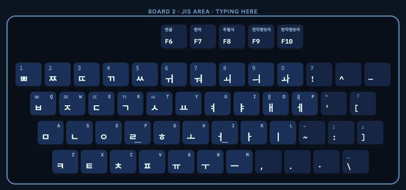

# JIS Korean

A Korean 2-set (두벌식) input method for JIS keyboards, for macOS, Minecraft, Windows and iPadOS, with a
browser playground.

**Try it in your browser: [jis-korean.sjun.me](https://jis-korean.sjun.me)**

- Spec: [docs/spec.md](docs/spec.md)
- `engine/`: core engine (shared by all platforms)
- `mac/`: macOS input method
- `minecraft/`: Minecraft (Fabric mod)
- `windows/`: Windows input method (TSF)
- `ipados/`: iPadOS (stub)
- `web/`: browser playground, deployed at [jis-korean.sjun.me](https://jis-korean.sjun.me)

## Build order

Platforms are built in this order: **macOS → Minecraft → Windows → iPadOS**.

Android and iPhone aren't planned here; they'll be covered by a separate input method.
