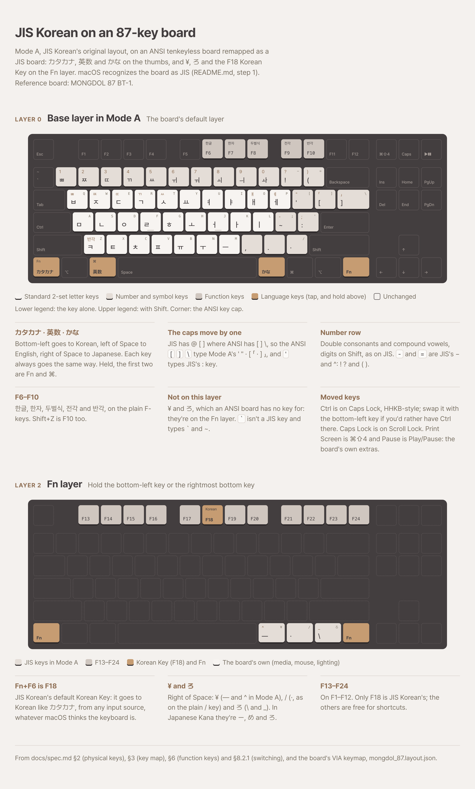

# macOS: an ANSI 87-key keyboard set up as a JIS board (recommended)

You can set up a remappable ANSI tenkeyless (87-key) keyboard, such as a QMK/VIA board, to work
like a JIS keyboard with JIS Korean on macOS. It then runs Mode A (`2Set`) and switches languages
the way spec §8.2.1 recommends for JIS keyboards, with one key per language: カタカナ goes to
Korean, 英数 to English and かな to Japanese. The ANSI board has no ¥ or ろ key, and JIS Korean's
backup Korean Key is F18. Both are on the Fn layer.

macOS has to recognize the board as a JIS keyboard (step 1). No remapping software is needed.

<picture>
  <source media="(prefers-color-scheme: dark)" srcset="layout-dark.png">
  
</picture>

In this folder:
- `layout.html`, the drawing above. To redraw `layout-light.png` and `layout-dark.png`, render it at 3×
  with headless Chrome, the same way as `docs/layout`.
- `mongdol_87.layout.json`, the reference board's VIA keymap. Import it in VIA, or read it for the
  keycodes. Layers 0 and 2 are the ones described here.

It takes two layers: **layer 0**, the base layer, and **layer 2**, the Fn layer. The reference board
is a MONGDOL 87 BT-1 over Bluetooth, remapped in VIA. On that board, Windows mode sets the default
layer to 0. The other layers (1 and 3, its Mac mode) aren't used here. On another board, use
whichever layer is its default and any momentary layer for Fn.

If you'd rather keep the board ANSI as it is, use Mode B (`2SetANSI`, spec §3.6) instead. It needs
no remapping, but it has no JIS switch keys.

## 1. Have macOS recognize the board as JIS

JIS Korean reads カタカナ only from keyboards macOS has stored as JIS (spec §8.2.1), and macOS types
¥ and ろ only on a JIS keyboard. Flash the keymap first (steps 2 and 3), since the setup below
needs the board's ろ key. Then:

1. Connect the board, and open System Settings → Keyboard → **Change Keyboard Type…** (Keyboard
   Setup Assistant).
2. Asked for the key right of the left Shift, press **Z**.
3. Asked for the key left of the right Shift, press **Fn + the third key right of Space**. That's
   ろ, which only JIS keyboards have, so macOS takes the board for JIS.
4. If it asks something else, or doesn't settle on JIS: press any key, then **Skip**, and choose
   **JIS** from the list.
5. Restart JIS Korean so it picks the board up: `pkill -x JISKorean`. It relaunches on the next key
   in a text field.

To check, look up the board's `product-vendor-0` entry (`12292-14000-0` for the reference board):
it should be 42.

```sh
defaults read /Library/Preferences/com.apple.keyboardtype
```

With the [diagnostic log](../troubleshooting/macos-katakana-and-eisu.md) on, a press of the
bottom-left key logs `hardware key 0x88 down`. Fn+F6 (F18, step 3) works either way.

### If that doesn't work: Karabiner's JIS virtual keyboard

The fallback leaves the board recognized as US ANSI (40) and lets Karabiner-Elements pass its keys
through its own virtual keyboard, stored as JIS:

1. In Karabiner-Elements → Devices, find the board and turn on **Modify events** and **Ignore vendor
   events**.
2. Store Karabiner's virtual keyboard (`593-1452-0`) as JIS (42). Karabiner's own "Virtual Keyboard:
   JIS" setting doesn't do this. Then restart JIS Korean:

```sh
sudo defaults write /Library/Preferences/com.apple.keyboardtype keyboardtype -dict-add "593-1452-0" -int 42
pkill -x JISKorean
```

The board's keys then reach macOS from a JIS keyboard, and JIS Korean reads カタカナ there
([#18](https://github.com/team-mirae/jis-korean/issues/18)). Don't add Karabiner rules that remap
`japanese_pc_katakana`, `international1` or `international3`. After changing Karabiner's device
settings, restart JIS Korean again.

## 2. Layer 0 (base)

Only the keys that differ from a stock ANSI TKL are listed. Keycodes are QMK/VIA names.

| Position | Keycode | Tap | Hold |
|---|---|---|---|
| Bottom-left (stock Ctrl) | `LT(2,KC_KANA)` | カタカナ (HID 0x88) → Korean | Fn (layer 2) |
| Second bottom-left key | `KC_LALT` | ⌥ | |
| Left of Space | `MT(MOD_LGUI,KC_HANJ)` | 英数 (HID LANG2) → English | ⌘ |
| Right of Space | `KC_HAEN` | かな (HID LANG1) → Japanese, handled by macOS | |
| Next two keys | `KC_RGUI`, `KC_RALT` | ⌘, ⌥ | |
| Rightmost bottom key | `MO(2)` | | Fn (layer 2) |
| Caps Lock | `KC_LCTL` | | Ctrl |

Ctrl to the left of A is HHKB-style. If you'd rather have Ctrl at the bottom left, swap the two
keys: Caps Lock's position gets `LT(2,KC_KANA)` (tap カタカナ, hold Fn) and the bottom-left key gets
`KC_LCTL`. Nothing else depends on where they are.

QMK's names for the language keys are Korean-centric. On macOS, `KC_HANJ` (LANG2) arrives as 英数
and `KC_HAEN` (LANG1) arrives as かな. `KC_KANA` is the Windows JIS カタカナ/ひらがな key, which
macOS doesn't have. JIS Korean reads that key at the hardware level, so Input Monitoring and
Accessibility must be granted (`mac/README.md`).

With a tap-hold key, the tap is sent when you release the key, so カタカナ and 英数 switch on
release.

The reference board also has a few extras that JIS Korean doesn't need:
- Print Screen sends `LSG(KC_4)` (⌘⇧4).
- Scroll Lock is `KC_CAPS`.
- Pause is Play/Pause.

## 3. Layer 2 (Fn)

| Position | Keycode | What it's for |
|---|---|---|
| F1 … F12 | `KC_F13` … `KC_F24` | **Fn+F6 = F18**, the default Korean Key (spec §8.2.1). It works without the JIS keyboard type. The others are free for shortcuts. |
| Right of Space | `KC_JYEN` | ¥ (`IntlYen`), for Mode A's ¥ key and the ー of Japanese Kana |
| Next key | `KC_SLSH` | / (`Slash`), the same as the plain / key |
| Next key | `KC_RO` | ろ (`IntlRo`), for Mode A's ろ key and Japanese Kana's ろ |
| Rightmost bottom key | `MO(2)` | stays Fn |

Everything else on the reference board's layer 2 (media, mouse, RGB keys and arrows on the right
hand) is the board's own and can be anything.

## 4. What the ANSI caps type as JIS

A JIS board sends the same key positions as ANSI wherever both have a key (spec §2). So once macOS
takes the board for JIS, a few caps type the JIS key in their place:

| ANSI cap | JIS key | Canonical code |
|---|---|---|
| `[` | @ | `BracketLeft` |
| `]` | [ | `BracketRight` |
| `\` (above Enter) | ] | `Backslash` |
| `=` | ^ | `Equal` |
| `'` | : | `Quote` |
| `` ` `` | none (半角/全角's position) | `Backquote`, which isn't in Mode A (spec §3.6) |

The tables in spec §3 give what each of these types in Mode A. In JIS English the symbols are JIS
ones, not the ones on the caps: Shift+2 is `"`, for example.

## 5. Known issues

- With Apple's ABC enabled, 英数 selects ABC instead of JIS English. Use ABC – Extended as the plain
  layout instead ([#2](https://github.com/team-mirae/jis-korean/issues/2)).
- After macOS's keyboard type changes for a board, restart JIS Korean (`pkill -x JISKorean`) so it
  reads the keyboards again.

## 6. Notes from setting up the reference board

- **Stored as JIS by hand, it didn't work at first.** Setting `12292-14000-0` to 42 with `defaults
  write` and restarting JIS Korean made it read the board's ¥, ろ and 英数 (`hardware key 0x89`,
  `0x87`, `0x91`), but カタカナ never arrived, and macOS didn't type ¥ or ろ. Karabiner-EventViewer
  showed the board sending the right usages all along (0x88, 0x89, 0x87). Karabiner's device
  settings were switched during that test, which may have played a part.
- **Then it worked, without Karabiner.** The one change before that: in VIA (usevia.app), the
  keycap legend language was set to **Japanese**. That's the language of the legends drawn on the
  keys, not of VIA's own interface. After that, Japanese Kana typed ー め ろ from the board's Fn keys, and
  JIS Korean read カタカナ, with Karabiner not modifying it. VIA's legend language should only
  change what VIA draws, so the cause isn't confirmed: it may have been the change, or a restart or
  reconnect around the same time. If step 1 alone doesn't work, try the same setting.

## 7. Alternatives

- **ろ on the backtick key.** You can assign `KC_RO` to the `` ` ``/`~` key (the top-left key, left of 1)
  on layer 0. Many katakana keycap sets come with an R1 keycap printed ロ for that spot. It works
  fine, and gives you a kana key without holding Fn. This guide leaves it out on purpose: it puts ろ
  under your left hand, while on a real JIS board ろ is at the right end of the bottom letter row.
  If you plan to type on a JIS board too, that habit gets in the way. It isn't recommended, but it's
  possible, and makes typing easier in the short term.
