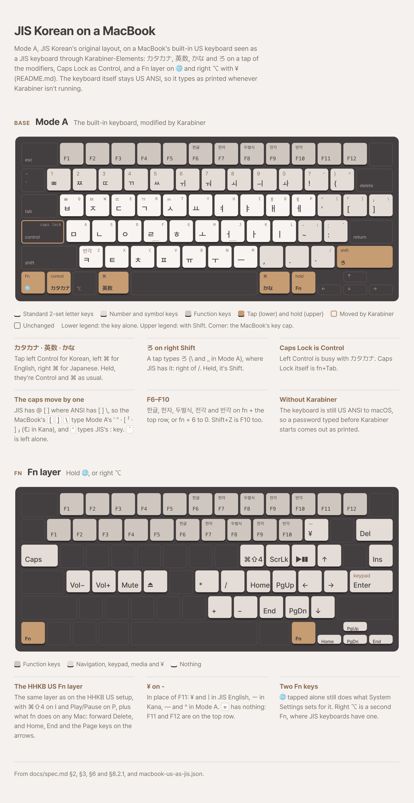

# macOS: a MacBook's built-in keyboard (US) as a JIS keyboard

Karabiner-Elements gives a MacBook's US ANSI keyboard the keys a JIS board has and it lacks: the
language keys and ろ as tap vs hold on the modifiers, ¥ on the Fn layer, and a second Fn on right
⌥, where JIS keyboards have one. The Fn layer is the one from
[the HHKB US setup](../legacy-hhkb-us-as-jis/README.md), on fn (🌐) and right ⌥. JIS Korean then
runs Mode A (`2Set`) on it, with one key per language as spec §8.2.1 recommends for JIS keyboards:
カタカナ to Korean, 英数 to English, かな to Japanese.

<picture>
  <source media="(prefers-color-scheme: dark)" srcset="layout-dark.png">
  
</picture>

In this folder:
- `layout.html`, the drawing above. To redraw `layout-light.png` and `layout-dark.png`, render it at 3×
  with headless Chrome, the same way as `docs/layout`.
- `macbook-us-as-jis.json`, the Karabiner-Elements rules.

## The keys

| Key | Tap | Hold |
|---|---|---|
| Left Control | カタカナ (`japanese_pc_katakana`) → Korean | Control |
| Left ⌘ | 英数 (`japanese_eisuu`) → English | ⌘ |
| Right ⌘ | かな (`japanese_kana`) → Japanese, handled by macOS | ⌘ |
| Right Shift | ろ (`international1`), where JIS has it: right of / | Shift |
| Caps Lock | Control | Control |
| fn (🌐) | 🌐, as usual | the Fn layer |
| Right ⌥ | | the Fn layer, a second Fn |

`` ` ``/`~` is left alone. No symbol keys are remapped: JIS Korean's Mode A and Japanese Kana read
each key by its position, as on a JIS board (see section 4 of
[the 87-key guide](../mac-ansi-87-key-recommended/README.md#4-what-the-ansi-caps-type-as-jis)).
¥ is fn+`-` (below), near where JIS has it: JIS's ¥ is left of Backspace. JIS's ] (む in Kana) is
the US `\` key, above Return, by position.

## The keyboard type stays US ANSI

The built-in keyboard keeps the type macOS gave it, US ANSI. While Karabiner modifies it, its keys
reach macOS through Karabiner's virtual keyboard, stored as JIS (`593-1452-0` = 42), and that's
what JIS Korean and Japanese Kana see. Without Karabiner (a password before it starts, or Karabiner
failing), the built-in keyboard types plain US ANSI, as printed.

The built-in keyboard can't be stored as JIS from the command line anyway: it reports vendor 0 and
product 0 and `KeyboardLanguage` "U.S.", and has no entry in
`/Library/Preferences/com.apple.keyboardtype`. macOS takes a built-in keyboard's type from the
hardware.

## The Fn layer

fn (🌐) or right ⌥, held, is the HHKB US Fn layer (the Mac extras version), with ¥ in place of
F11, and keeps what fn does on a Mac:

| fn + | Sends |
|---|---|
| 1 … 0 | F1 … F10 (F6–F10: 한글, 한자, 두벌식, 전각, 반각) |
| - | ¥ (`international3`): ¥ and \| in JIS English, ー in Kana, — and ^ in Mode A |
| F1 … F12 (top row) | F1 … F12, as macOS does |
| Delete | forward Delete, as macOS does |
| ← → ↑ ↓ | Home, End, Page Up, Page Down, as macOS does |
| `\` | Insert |
| Tab | Caps Lock |
| I / O / P | ⌘⇧4 (a screenshot of a selection) / Scroll Lock / Play/Pause |
| [ ; ' / | ↑ ← → ↓ |
| K L , . | Home, Page Up, End, Page Down |
| H J N M | keypad * / + − |
| Return | keypad Enter |
| A S D F | volume down, volume up, mute, eject |

`=` has nothing on the layer: F11 and F12 would be confusing next to ¥, and the top row has them.

fn is used by the layer, not passed on: 🌐 + a letter shortcuts (🌐E for emoji, 🌐F for full screen
and the like) no longer reach macOS. A tap of fn alone still does what System Settings → Keyboard
sets for 🌐.

## Setup

1. **Karabiner's virtual keyboard as JIS** (42), if it isn't already:

   ```sh
   defaults read /Library/Preferences/com.apple.keyboardtype          # 593-1452-0 should be 42
   sudo defaults write /Library/Preferences/com.apple.keyboardtype keyboardtype -dict-add "593-1452-0" -int 42
   ```

2. **The rules.** Copy [macbook-us-as-jis.json](macbook-us-as-jis.json) to
   `~/.config/karabiner/assets/complex_modifications/`, then Karabiner-Elements → Complex
   Modifications → Add predefined rule, and enable both: **[Fn]** above **[required]**. They only
   act on the built-in keyboard.
3. **Karabiner → Devices:** turn on **Modify events** for the Apple Internal Keyboard.
4. Restart JIS Korean so it reads the keyboards again: `pkill -x JISKorean`.

JIS Korean needs Input Monitoring and Accessibility for カタカナ (`mac/README.md`). Don't add other
Karabiner rules that remap `japanese_pc_katakana`.
