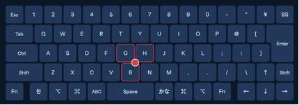

# ipados

JIS Korean for iPadOS. Stub for now.

## Reference keyboard

The iPadOS version is built against this keyboard:

- **JIS layout:** ¥ left of Backspace, `@` `[` right of P, `:` `]` right of L. JIS Korean's extra
  keys (spec §3) are all there.
- **Bottom row:** Fn, **한**, ⌥, ⌘, **ABC**, Space, **かな**, ⌘, ⌥, then ← ↓ →. Like the 英数 and
  かな keys on a Mac JIS board, ABC and かな sit either side of Space, and a dedicated 한 key sits
  left of ⌥.
- **Pointing stick** between G, H and B.
- No Control key in the bottom row: Ctrl is left of A.
